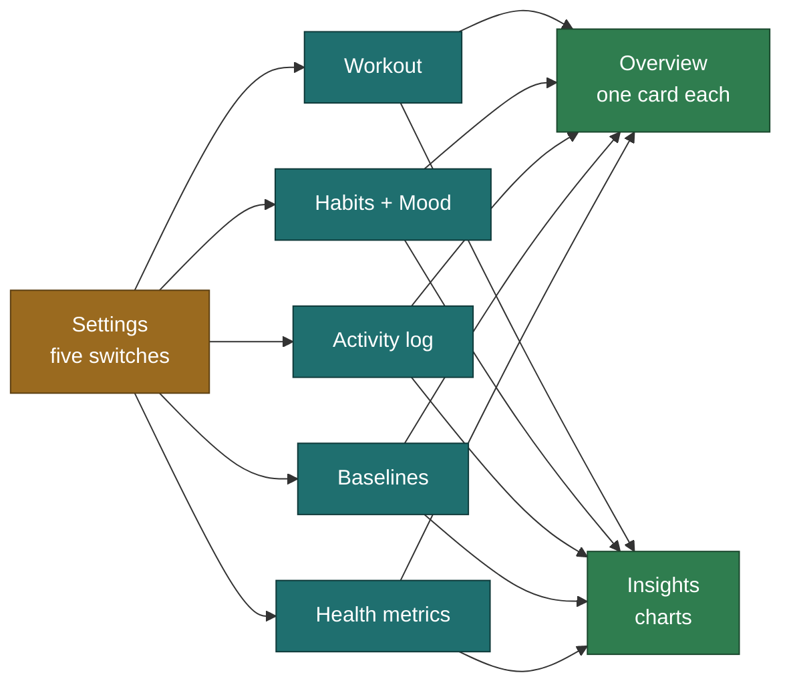

# CosmicWorkOut

**A fast, offline-first tracker for following a structured strength plan — and logging the rest of your day — entirely on your own device.**

CosmicWorkOut is a personal training notebook, not a fitness product. No account, no backend, no sync, no ads. You open it, log what you did in a couple of taps, and get on with your life. Everything you record stays on your device.

---

## Why it exists

Most fitness apps are either too simple (a notes app) or too complex (a gym-management platform), and almost all of them assume one kind of training and an always-on connection. CosmicWorkOut aims for the underserved middle: **structured, multi-week programs with real flexibility, that work offline, and treat each new movement type as configuration rather than a rewrite.**

The one friction it refuses to add: logging what you just did should take **under five seconds, one-handed, without thinking.**

---

## First run: turn on what you want

**Every tracker is opt-in and starts off.** A fresh install shows an empty Overview with a **Choose what to track** link. Go to **Settings**, open a feature, and flip its switch. Turning a feature off later only hides it — your data stays.



---

## What you can do

**Trackers** (each one has its own switch in Settings):

- **Workout** — run one Strength plan at a time, built from a Strength course program (Beginner / Intermediate 101–103) or from scratch, over a built-in exercise library. Set tiles log weight × reps in one tap and remember your last weight. Optionally give a plan a **goal lift** (weight × reps) and the app generates build → peak → deload waves to get you there. A crash mid-session offers to resume.
- **Habits + Mood** — Water, Coffee, Meditation, Writing, Reading, plus your own; counters, minutes, and toggles with progress rings, and a −5 … +5 mood check-in.
- **Activity log** — quick entries for runs, walks, rides, sports, yoga, and more, with duration and intensity.
- **Baselines** — your own daily floors (duration, distance, or count), logged as often as you like and compared against the baseline.
- **Health metrics** — weight and blood pressure (with optional pulse).

**Always there:**

- **Overview** — today at a glance, one card per tracker, in the order you choose, with a week strip and streak.
- **Any day, not just today** — one date picker in the header sets the day you're logging or fixing.
- **Insights** — charts with date ranges; hide the ones you don't want.
- **Personalization** — weight unit, density, haptics, sound, and card order.
- **Own your data** — works fully offline and installs as a PWA. Export a complete JSON backup and restore it anytime, or **send a backup to another device by QR code** — no network needed.

How the switches work, and exactly what each one hides: **[Feature toggles](docs/architecture/feature-toggles.md)**.

---

## Get it running

```sh
npm install
npm run dev    # http://localhost:5678 — also on your LAN for phone testing
```

| Command              | What it does                             |
| -------------------- | ---------------------------------------- |
| `npm run dev`        | Dev server on port 5678 (with `--host`)  |
| `npm run build`      | Static production build                  |
| `npm run preview`    | Serve the production build               |
| `npm test`           | Pure-logic unit tests (Node test runner) |
| `npm run check`      | TypeScript + Svelte type check           |
| `npm run lint`       | Prettier + ESLint (writes fixes)         |
| `npm run docs:links` | Check the wiki's links and anchors       |

**Tip:** Settings → Data & backup → **Load debug data** fills in ~6 months of history. It doesn't turn any tracker on, so switch on the ones you want to see.

Project facts and conventions: **[Project facts](docs/standards/project.md)** and the **[Working agreement](docs/standards/working-agreement.md)**.

---

## Learn more

- **How does it work?** The **[wiki home](docs/README.md)** links one page for each part of the app — Workout, Habits, Insights, backups, and the rest.
- **What words does it use?** The **[Glossary](docs/glossary.md)**.
- **What shipped when?** The **[Features list](docs/features/README.md)** — every release and its user stories.

Built with **Svelte 5 + SvelteKit** (static adapter, client-only) and **TanStack Charts**; data lives in IndexedDB + localStorage. See the [Tech Stack](docs/architecture/tech-stack.md).
