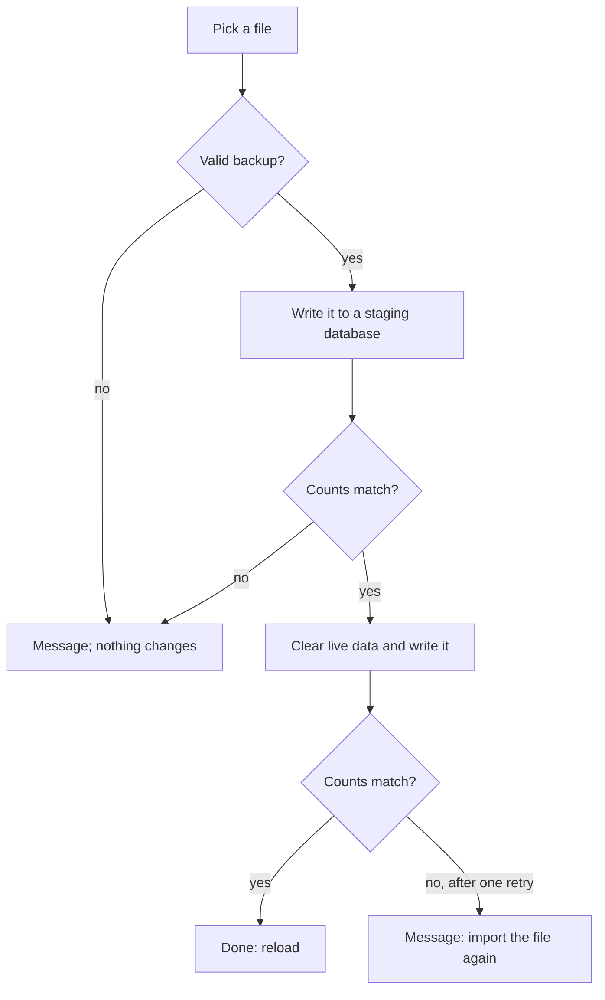

[Wiki](../README.md) / [Data and backup](data-and-backup.md) / File backup

# File backup

A restore is the one action that the user cannot undo: it replaces everything. If it fails halfway, the old data is gone and the new data is not there. This page tells how the app makes that failure almost impossible.

## Export

Export reads each IndexedDB store and the localStorage keys that a backup carries. It puts them in one JSON object with a version number and the time, and gives you the file. A few months of history is about 1 MB.

## Restore, step by step

1. **Check the file.** A file larger than 50 MB is refused before the app reads it, so a wrong file cannot freeze the tab. The app refuses a file with no version, a file from a newer version of the app, and a file whose stores are not lists.
2. **Warn.** The confirmation lists data on the device that the backup cannot replace — for example, a backup made before baselines existed has none, so a restore removes yours.
3. **Stage.** The app writes the whole backup into a second, temporary database, and counts each store. If a write or a count fails, it deletes the staging database, and your live data was never touched.
4. **Commit.** Only now does it clear the live stores and write the backup into them, and count again. If this fails, it tries once more from the same prepared data. If that fails too, it keeps the staging database and tells you to import the same file again.
5. **Finish.** It removes the session in progress, writes the backup's localStorage keys, and writes the built-in content again. Then the app reloads.

## Why two databases

The staging step proves that every record can be stored — the right shape, nothing that the database rejects — before any data is lost. The risk moves from "your data is gone" to "the restore did not start".

## Old backups

A backup from an older version restores, with two rules. A store that the backup does not have ends up empty, and the warning in step 2 says so. Baselines of the oldest shape cannot be read, so the restore skips them and restores the rest.

### Example

You restore a file with 412 sessions. The staging database receives 412 sessions and counts 412. The live store is cleared, receives 412, and counts 412. The app reloads with your data.

## Further reading

- [QR backup](qr-backup.md): the same backup, carried by QR codes.
- [Schema upgrades](schema-upgrades.md): why built-in content is written again after a restore.
