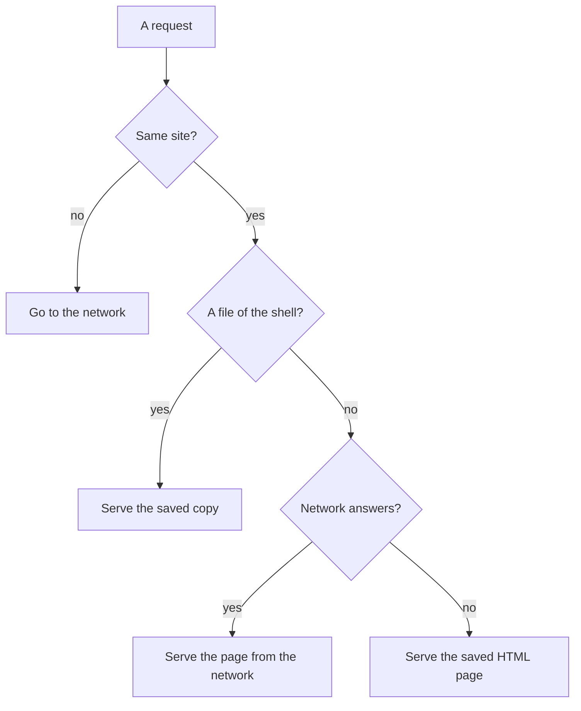

[Wiki](../README.md) / [System](system.md) / Offline

# Offline

The app must work with no network from the moment that it opens. This page tells how it serves itself offline, how an update arrives, and how you install it.

## How the service worker answers a request

On the first visit, a service worker saves a copy of the app shell: the code, the styles, the fonts, the icons, and the one HTML page. After that, it answers each request of the app.

The files of the shell never change within one build, so the saved copy is always right. Any other request tries the network first and saves a copy of a good answer. With no network, a page request gets the saved HTML page. The app has only one HTML page for every route, so a deep link opens also offline.

## How an update arrives

Each build has its own version, and the name of the saved copy holds that version. When you open the app after an update, the browser installs the new service worker. The new worker saves the new shell and deletes the old copies. Your data is not part of the shell, so an update never touches it.

## Install on a phone

The app has a manifest and icons, so a phone can add it to the home screen. It then opens like an app, with no browser bar. Install and the service worker need a secure origin: HTTPS, or `localhost`. The dev server on the local network is plain HTTP, so a phone that uses it gets no offline copy. On iPhone, you install by hand: Share, then Add to Home Screen.

### Example

You train in a basement gym with no signal, and you open a bookmark to `/habits`. The code and the styles are files of the shell, so the worker serves its saved copies. The page request fails on the network, so the worker serves the saved HTML page, and the app opens on Habits. You log a glass of water, and it saves on the device as on any other day.

## Further reading

- [Storage](storage.md): what the browser can delete, and when.
- [QR backup](qr-backup.md): moving data to a second phone with no network.
