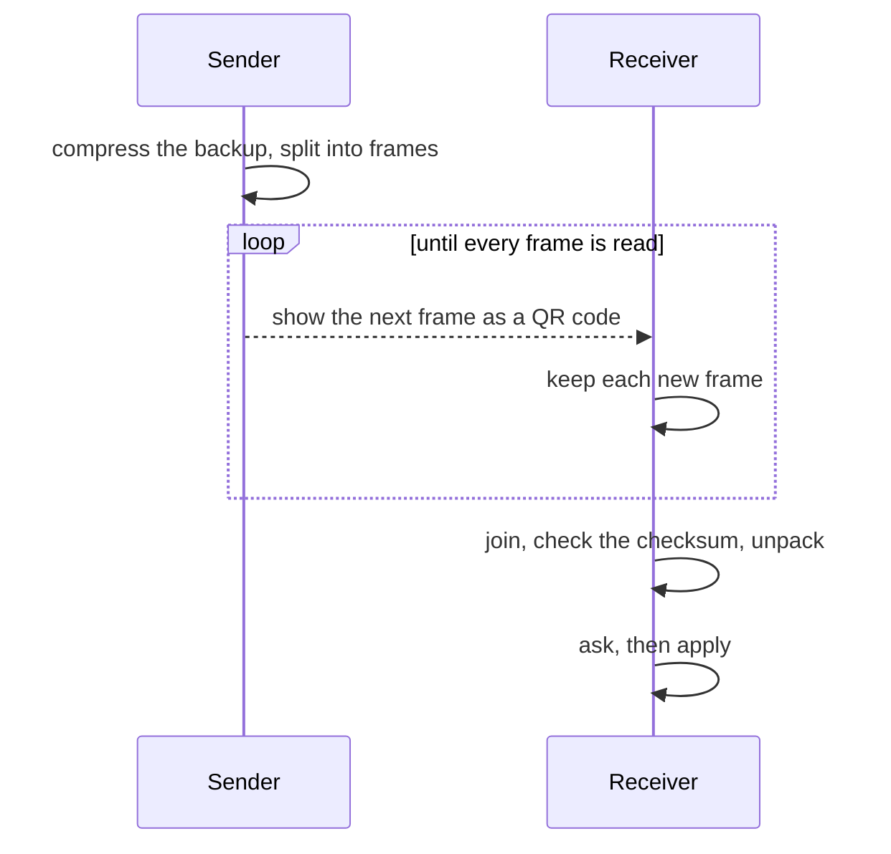

[Wiki](../README.md) / [Data and backup](data-and-backup.md) / QR backup

# QR backup

You want your phone's records on your laptop, with no cable, no cloud, and no network. The QR backup shows the data as a loop of QR codes on one screen, and the other device reads them with its camera.

## What the sender sends

You pick a range: **Since last** (when this device sent before), the last 30 days, the last 90 days, or **All**. A range of days sends only the records dated in it, plus every definition — your habits, plans, custom items, baselines, and goals — and none of your settings. All sends everything, with your settings. Built-in items and templates are never sent, because every device writes them on start.

## From data to frames



The sender compresses the JSON and splits the bytes into frames. Each frame is one QR code with this form:

```text
CW1:<id>:<index>:<total>:<data in base45>
```

- `id` is the CRC-32 of the whole compressed backup, as 8 hex digits. It names the transfer and is the checksum.
- Every character is in the QR alphanumeric set, which packs about 30% more data into a code than byte mode.
- Each frame holds 250, 450, or 800 bytes (low, medium, or high density), and shows for 500, 250, or 150 ms (slow, normal, or fast). A lower density makes a code that a weak camera reads more easily.

## The receiver

The receiver keeps each frame that it has not seen, in any order, so a missed frame comes round again in the next loop. A frame with a new id, or the same id with a new total, starts a new transfer. When every frame is in, the receiver joins them, checks the CRC against the id, and unpacks. It then shows what it will change and asks first.

## How each range applies

**All** replaces every record, as a [file backup](file-backup.md) does. A **range of days** deletes and replaces only the dated records in that range, and adds or updates each definition; it never deletes a definition. It keeps the settings and any session in progress on the receiver. It runs as one transaction, so a failure leaves the device as it was.

### Example

On Sunday your phone sends "Since last", last sent Wednesday: four days of records. At medium density this is a short loop. Your laptop reads it in a few seconds, asks you to apply that range, and replaces those four days. The next send from the phone starts at Sunday.

## Further reading

- [Offline](offline.md): why this works with no network at all.
- [localStorage keys](local-storage-keys.md): which keys a range of days carries.
