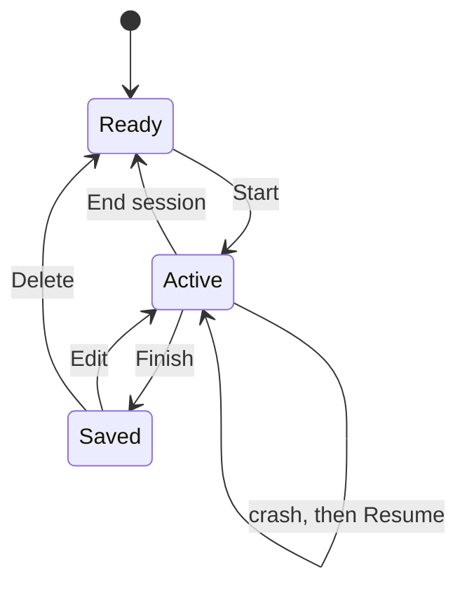

[Wiki](../README.md) / [Workout](workout.md) / Session lifecycle

# Session lifecycle

A session is the one place where you can lose work: the phone locks, the browser closes, a call comes in. This page tells how a session moves from start to saved, and why no set that you saw on screen is lost.

## The states

## Start

You tap **Start** on today's routine. The session opens as an overlay, and the app writes it to localStorage at once. Each item starts with the weight from your last session of that item, or the weight that a goal gives for this week. If the logging date is not today, the app first asks if you want to log on that date.

## While you train

Each set that you log is written to the session in localStorage at once, with no batch and no delay. So the stored copy always matches the screen. The app also stores the new last weight of the item, as [set logging](set-logging.md) tells.

## Finish

The footer button says **Finish session** when every set is done, and **Finish early · 9/12 sets** when some are not. It asks no question. The app stores only the completed sets, with the duration, the total sets, and the volume — the sum of weight × reps. Then it removes the copy in progress and shows the result screen.

## End without saving

The back arrow asks "End this session?". If you confirm, the app removes the copy in progress, and nothing goes into IndexedDB. This has a question, because it throws work away.

## Edit and delete later

A saved session shows Edit and Delete on the routine screen for its date. Edit opens it again with its sets filled in. The session keeps its first finish time and duration, so an edit a week later does not make a long session. The back arrow then asks "Discard changes?".

## Resume after a crash

When the app starts with a session in localStorage, it shows a banner with **Resume** and **Discard**, whatever the date of that session. This runs only when Workout is on. Resume opens the overlay with every logged set; Discard removes the copy.

### Example

You log 7 of 12 sets, and the phone dies. You charge it and open the app. The banner asks to resume. You tap Resume, log the last 5 sets, and tap **Finish session**. The session saves with all 12 sets.

## Further reading

- [Boot](boot.md): when the app looks for a session in progress.
- [Workout records](workout-records.md): the fields of a session and of a session in progress.
