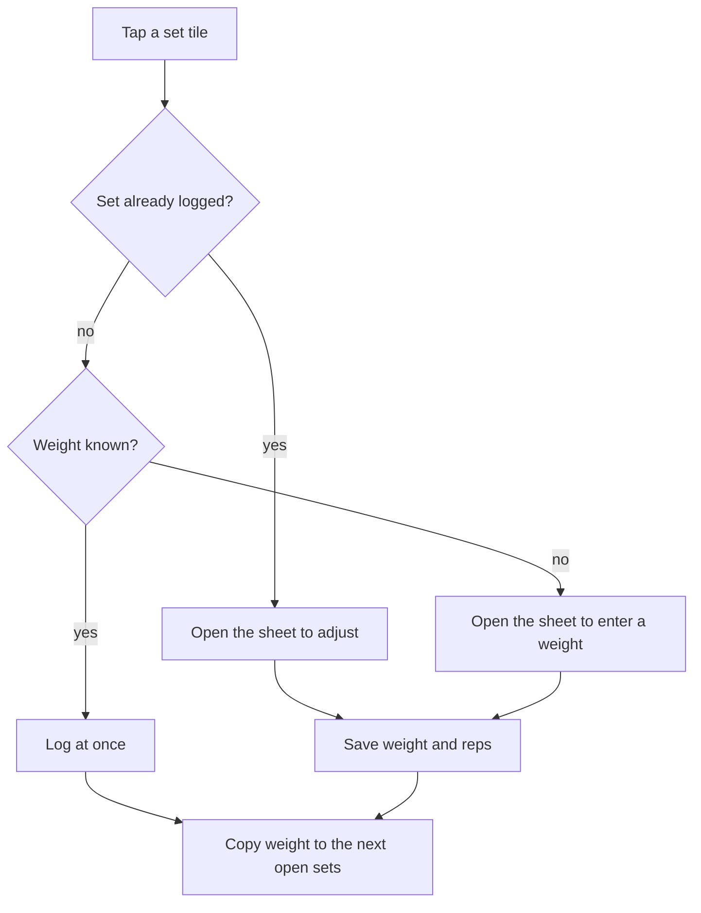

[Wiki](../README.md) / [Workout](workout.md) / Set logging

# Set logging

You put the bar down, and you have a few seconds. The app must log the set in one tap when it can, and ask only when it must. This page tells how it decides.

## What one tap does

The weight is known when the item uses a band or bodyweight, or when the set already has a weight. A set has a weight when you lifted this item before, when an earlier set of this session set one, or when a goal gives the weight of this week. So only the first time that you ever do an exercise needs the sheet.

## The sheet

The sheet has a field for the weight and one for the reps. It rounds the weight to the weight step of the item — 2.5, 5, or 10 — so 47 with a step of 5 becomes 45. The weight step is set on the item, because a dumbbell moves in steps that a barbell does not.

## A new weight moves forward

When you log or adjust a set, its weight goes to each later set of the same item that is not logged yet. A logged set keeps its own weight. So when the third set is too heavy and you drop the weight, the fourth and fifth follow, and the first two stay true.

## The app remembers

Each logged set writes two things at once. The session in progress goes to localStorage, so a crash loses nothing. The weight and reps go to the last-used record of the item, so the next session starts there. The next session therefore starts at the weight that you last lifted, and you raise it by hand when you are ready.

## Feedback

A logged set gives a `success` buzz, and the tile stamps down. When the last set of an item is done, a stamp lands and the blue plate moves to the next exercise, with a `win` buzz. The [tap feel](tap-feel.md) page tells the full list.

### Example

Bench Press, three sets of 8, last week at 135 lb. The first open tile says "Now", and the others show "+". You tap set 1, and it logs at once at 135 × 8. You log set 2, but it was hard, so you tap it again, change it to 130, and save. Set 3 now holds 130, and logs at 130 when you tap it. Next week, Bench Press starts at 130.

## Further reading

- [Session lifecycle](session-lifecycle.md): what occurs when you finish or end.
- [Item library](item-library.md): where the weight step of an item is set.
