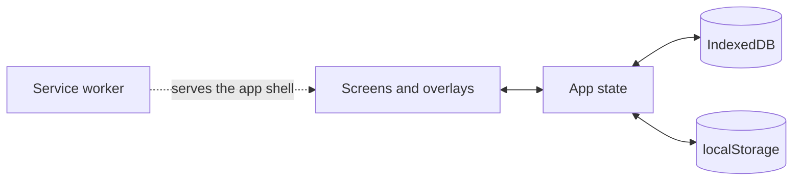

[Wiki](../README.md) / System

# System

CosmicWorkOut is a web app with no server, no account, and no sync. After the first visit, all of it runs in the browser of your phone, and all of your data stays there.

## Why there is no server

The people who use the app train in places with a weak signal. A server would add a spinner to each tap and a way to lose a set. So each write goes to storage on the device at once, and the network is never on the path of a tap. The cost is that data does not move between devices by itself; you move it with a [backup](data-and-backup.md).

## The pieces and how they connect

- **Screens and overlays.** Each screen reads and changes the app state. The active session and its result show as overlays above the screen, so you never leave a session by accident. The [navigation](navigation.md) page tells how you move between screens, and the [design system](design-system.md) tells how each one looks.
- **App state.** One store for each part of the app — the plans, the session, the habits, and so on. A store loads its records when the app starts, keeps them in memory, and writes each change to storage at once. A screen that reads a store updates by itself when the store changes.
- **On-device storage.** Records that grow over time live in IndexedDB. Small values that the app must read before the first screen, such as your settings and the session in progress, live in localStorage. The [storage](storage.md) page tells which is which, and why.
- **Service worker.** It keeps a copy of the app, so the app opens with no network. The [offline](offline.md) page tells how it decides what to serve.

## What happens when you open the app

The app shows no screen until the database is open and every store is loaded. The [boot](boot.md) page gives the steps and what occurs when one fails.

## What the trackers share

Each tracker has its own store and its own screens, but all of them read one [logging date](logging-date.md), and each one hides behind its own [feature toggle](feature-toggles.md).

### Example

You tap plus on the Water tile. The Habits screen asks the habit store to log 3 cups for the logging date. The store writes the habit log to IndexedDB, and then keeps it in memory. The tile reads the store, so it shows `3/4` at once. The Overview card reads the same store, so it is current when you go back. No request leaves the phone.

## Further reading

- [Tech stack](tech-stack.md): the framework and tools, and why each was selected.
- [Design principles](../principles.md): the rules that made offline first a hard limit.
