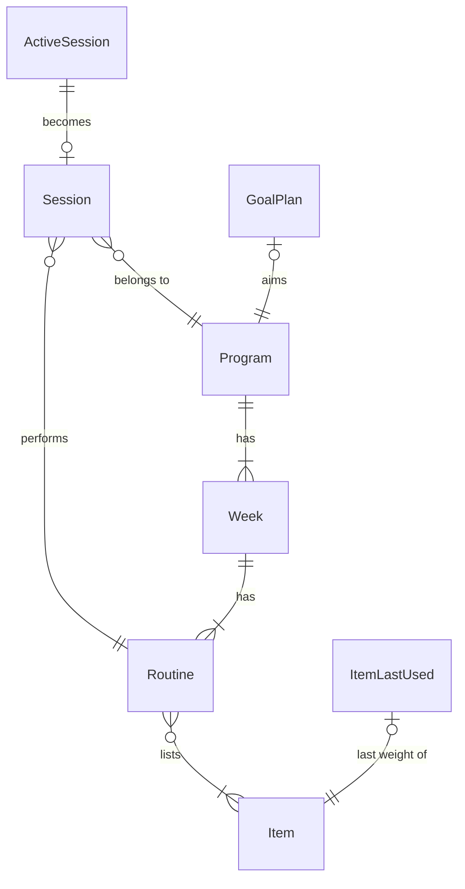

[Wiki](../README.md) / [System](system.md) / [Storage](storage.md) / Workout records

# Workout records

This page is the contract for the records that Workout stores. Use it to read the data, to write a migration, or to check a backup by hand.

## How the records connect

## Program — the stored plan

| Field           | Rule                                                                   |
| --------------- | ---------------------------------------------------------------------- |
| `id`            | Unique. Built-in ids start with `st-`, such as `st-beginner-101`       |
| `disciplineId`  | Always `strength`                                                      |
| `name`          | Shown in the plan list                                                 |
| `durationWeeks` | The number of weeks. The week counter stops at this number             |
| `daysPerWeek`   | The number of routines in one week                                     |
| `weeks`         | One entry for each week. Each week has its own copy of the routines    |
| `isBuiltIn`     | `true` for a template. The app never edits a template; you edit a copy |

## Routine and item

A routine has an `id`, a `name`, an optional `letter` (`A`, `B`, `C`), and its sections. Strength has one section, `exercises`. Each entry in a section names an `itemId`, a number of `sets`, and target `reps` as text, such as `"8-10"`.

An item has an `id`, a `name`, a `disciplineId`, the `section` that it belongs to, a `cue` to show during a session, a body-part category, a `unit` (`lb`, `kg`, `band`, or `bodyweight`), default sets and reps, and a `weightIncrement` of 2.5, 5, or 10.

## Session

| Field                     | Rule                                                             |
| ------------------------- | ---------------------------------------------------------------- |
| `disciplineId`            | Always `strength`. The streak and the session count read it      |
| `date`                    | The logging date, year-month-day. One session per plan per date  |
| `programId`, `routineId`  | The plan and the routine that you did                            |
| `startedAt`, `finishedAt` | Times in ISO form                                                |
| `durationSeconds`         | Seconds from start to finish                                     |
| `totalVolume`             | The sum of weight × reps for each set with a number weight       |
| `totalSets`               | The number of logged sets                                        |
| `items`                   | For each item: its logged sets, each with weight, reps, and time |

Only completed sets go into a session. A set that you did not log is not stored.

## Session in progress and last weight

The session in progress has the same items, but each set also has its target reps and a `completed` flag. It lives in localStorage, not IndexedDB. The last weight of an item is one row: `itemId`, `weight`, `reps`.

## Goal

A goal record holds the `programId` of its plan, the `focusItemId`, the `start` and the `goal` as weight × reps, the weight step of the focus lift, the progression blocks, the start weight of each supporting exercise, a `status` of `active`, `paused`, or `completed`, and a `countOffset` that a repeated block adds. To remove a goal deletes only this record; the plan continues.

## Further reading

- [Goal wave](goal-wave.md): how the progression blocks are made.
- [Next routine](next-routine.md): how the session count picks the routine.
