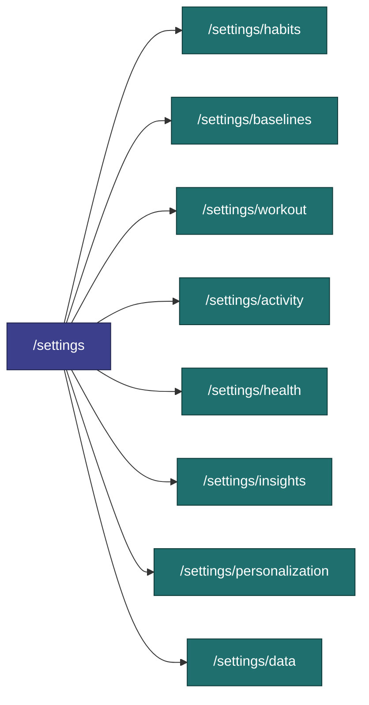
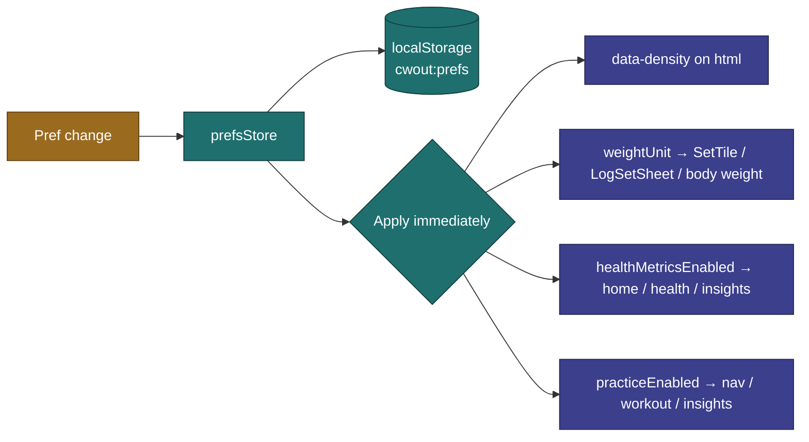

[Wiki](../README.md) › [5k — Requirements](../README.md#5k--requirements) › Settings & Preferences

# Settings & Preferences

User-configurable behavior and appearance.

**Tied to:** [Data Model — UserPrefs](../architecture/data-model.md) | [State Management](../implementation/state.md)

---

## Implementation Status

| Story                                        | Status    | Notes                                                                                                                                                                                              |
| -------------------------------------------- | --------- | -------------------------------------------------------------------------------------------------------------------------------------------------------------------------------------------------- |
| Preferences store + localStorage persistence | Built     | `prefsStore` ↔ `cwout:prefs`                                                                                                                                                                       |
| Settings hub + sub-routes (`/settings`)      | Built     | One row per feature since v1.10.0 ([US-045](../features/v1.10.0/US-045-settings-feature-hub.md)); originally [US-030](../features/v1.7.0/US-030-settings-restructure.md)                           |
| Health metrics master toggle                 | Built     | On `/settings/health` ([US-029](../features/v1.7.0/US-029-health-metrics.md), moved by US-045)                                                                                                     |
| Baselines master toggle + Settings CRUD      | Built     | [US-034](../features/v1.9.0/US-034-baselines-setup.md)                                                                                                                                             |
| Habits / Activity log master toggles         | Built     | Both default off; every tracking feature is opt-in                                                                                                                                                 |
| Workout master toggle                        | Built     | On `/settings/workout` ([US-052](../features/v1.10.0/US-052-one-workout-section.md)); default off; covers plans and their optional goals (replaces the old separate Practice + Lift plans toggles) |
| Overview card order (`homeCardOrder`)        | Built     | Drag or arrows on Personalization (and `/settings/overview`); `src/lib/homeCards.ts`                                                                                                               |
| Weight unit applied in display/input         | Built     | Default `lb`; a **label only** — switching does not convert stored readings                                                                                                                        |
| Haptics / sound                              | Built     | On Personalization → Feedback. `hapticsEnabled` default on (switch hidden where the browser can't vibrate); `soundEnabled` default off ([US-056](../features/v1.12.0/US-056-tap-feel.md))          |
| Density applied on boot                      | Built     | Density scales every `--space-*` token (compact ×0.75, spacious ×1.25)                                                                                                                             |
| Accent color / roundness                     | Removed   | v1.12.0 ([US-055](../features/v1.12.0/US-055-color-fields-redesign.md)) — fixed domain hues and square corners ([Design System](../architecture/design-system.md))                                 |
| Personalization page                         | Built     | `/settings/personalization` — weight unit, density, card order ([US-046](../features/v1.10.0/US-046-personalization.md); trimmed in v1.12.0)                                                       |
| Insights chart visibility (`hiddenCharts`)   | Built     | `/settings/insights` + ⋯ → Hide on each chart ([US-043](../features/v1.10.0/US-043-insights-chart-visibility.md))                                                                                  |
| Light mode (`theme`)                         | Removed   | Shipped in v1.10.0 ([US-048](../features/v1.10.0/US-048-light-mode.md)); removed in v1.12.0 — the app is dark only ([US-055](../features/v1.12.0/US-055-color-fields-redesign.md))                 |
| Completion feel toggle                       | Not built | No `completionFeel` pref; the completion confetti always plays                                                                                                                                     |
| Per-item weight increment (2.5 / 5 / 10)     | Built     | Set on the item form, not in global prefs                                                                                                                                                          |
| Clear workout data                           | Built     | On `/settings/data`; wipes IndexedDB + session state                                                                                                                                               |
| Reset preferences to defaults                | Built     | `prefsStore.resetToDefaults()`                                                                                                                                                                     |

> **Appearance UI note:** `density` and `weightUnit` are editable on **Settings → Personalization** ([US-046](../features/v1.10.0/US-046-personalization.md)). `theme`, `accentColor`, and `roundness` were removed in v1.12.0 ([US-055](../features/v1.12.0/US-055-color-fields-redesign.md)); old stored values are ignored on load and dropped on the next save. The completion-feel story below still describes target UX only.

---

## Settings Information Architecture

Reshaped in [US-045](../features/v1.10.0/US-045-settings-feature-hub.md) (v1.10.0): **one row per feature**, iPhone-Settings style. Each row shows On / Off and opens that feature's page, which holds its switch, its manage list, and its own options. (Originally [US-030](../features/v1.7.0/US-030-settings-restructure.md).)

| Route                              | Contents                                                                                                                                                              |
| ---------------------------------- | --------------------------------------------------------------------------------------------------------------------------------------------------------------------- |
| `/settings`                        | **Hub** — Features: Habits · Baselines · Workout · Activity · Health. App: Insights · Personalization · Data & backup                                                 |
| `/settings/habits`                 | Habits switch; habit CRUD, reorder, active toggle, colors; Mood colors                                                                                                |
| `/settings/baselines`              | Baselines switch; baseline CRUD ([US-037](../features/v1.10.0/US-037-flexible-baseline-metrics.md))                                                                   |
| `/settings/workout`                | One **Workout** switch, covering plans and their optional goals ([US-052](../features/v1.10.0/US-052-one-workout-section.md)) — replaces the old `/settings/practice` |
| `/settings/activity`               | Activity log switch                                                                                                                                                   |
| `/settings/health`                 | Health metrics switch                                                                                                                                                 |
| `/settings/insights`               | Show / hide each Insights chart                                                                                                                                       |
| `/settings/personalization`        | Weight unit, density, haptics, sound, Overview card order                                                                                                             |
| `/settings/overview`               | Overview card order (kept for old links)                                                                                                                              |
| `/settings/data`                   | Export / restore ([US-028](../features/v1.7.0/US-028-data-export-backup.md)), Send / Receive by QR, clear data, debug seed                                            |
| `/settings/data/send` · `/receive` | QR backup ([US-057](../features/v1.12.0/US-057-send-backup-by-qr.md), [US-058](../features/v1.12.0/US-058-receive-backup-by-qr.md))                                   |

Settings feature pages are never gated by their own flag — they hold the switch that turns the feature on. Destructive and infrequent actions live on **Data & backup**.

### Feature toggles

Every feature toggle defaults **off** and hides UI only — data always persists ([state.md](../implementation/state.md#feature-flags-hide-ui-data-always-persists)).

| Toggle                 | Covers                                                                                                                                                                                                                              |
| ---------------------- | ----------------------------------------------------------------------------------------------------------------------------------------------------------------------------------------------------------------------------------- |
| `habitsEnabled`        | Habits **and mood** — daily check-in, CRUD, dots, charts                                                                                                                                                                            |
| `activityLogEnabled`   | The activity log — runs, walks, yoga, and other one-off activities                                                                                                                                                                  |
| `practiceEnabled`      | The whole Workout section — plans and their optional goals, plus its Insights marks (v1.10.0, [US-052](../features/v1.10.0/US-052-one-workout-section.md) folded the old separate `goalProgressionPlansEnabled` flag into this one) |
| `healthMetricsEnabled` | Weight and blood pressure                                                                                                                                                                                                           |
| `baselinesEnabled`     | Daily baselines (1 to n metrics each)                                                                                                                                                                                               |

**Everything is opt-in**, so a fresh install tracks nothing. Overview shows a "choose what to track" empty state rather than a blank page.

A goal is no longer a separate flag — it's just an option set when a plan is created at `/workout/new`, so the single `practiceEnabled` switch covers it.

Mood has no toggle of its own — it is a protected habit, locked _inside_ Habits but hidden along with it.

### Overview card order

Which feature sits at the top of Overview is the user's call, not a hardcoded default — some people lead with Habits, others with the Activity log. `homeCardOrder` holds the order, edited on **Personalization** (also `/settings/overview`) by drag or arrow buttons. Details and the stale-value repair rule: [state.md](../implementation/state.md#overview-card-order).

---

## Goal

A small set of meaningful preferences that change how the app feels and behaves — nothing more. No settings for the sake of settings.

---

## User Stories

### Choosing Weight Units

> As a user, I want to track weight in my preferred unit (lbs or kg).

- Toggle between `lb` and `kg`
- Applies to all display and input throughout the app
- Historical logs store the raw number — unit preference determines how it's displayed

---

### Adjusting Completion Feel

> As a user, I want to tone down animations if I find them distracting.

- **Full** (default) — confetti on session complete, full ring animation on exercise complete
- **Subtle** — skip confetti, use minimal completion indicators

Separate from `prefers-reduced-motion` (which is a system setting). This is a conscious user choice within a normally-animated context.

---

### Adjusting Visual Density

> As a user, I want the UI to feel comfortable on my specific device.

Three values in storage (applied via `data-density` on `<html>`):

- **comfortable** (default) — standard tile height and gaps
- **compact** — tighter spacing
- **spacious** — more room between elements

---

## Constraints

- Preferences are stored in `localStorage` — synchronous reads, always available
- Changes apply instantly — no "Save" button
- No account, no sync — preferences are device-local

---

## Out of Scope for v1

Deferred items on [roadmap](../roadmap/README.md): per-exercise rest timer, notifications. Light mode shipped in v1.10.0 ([US-048](../features/v1.10.0/US-048-light-mode.md)) and was removed in v1.12.0 — the app is dark only. See [Design Principles](../vision/principles.md#4-tactile-and-satisfying--dark-only).

---

## Related

- [Data Model — UserPrefs](../architecture/data-model.md)
- [Session Logging](session-logging.md) — Where weight increment and completion feel are applied
- [Design Principles](../vision/principles.md) — Why dark only and small surface area
- [US-030 — Settings Hub Restructure](../features/v1.7.0/US-030-settings-restructure.md)
