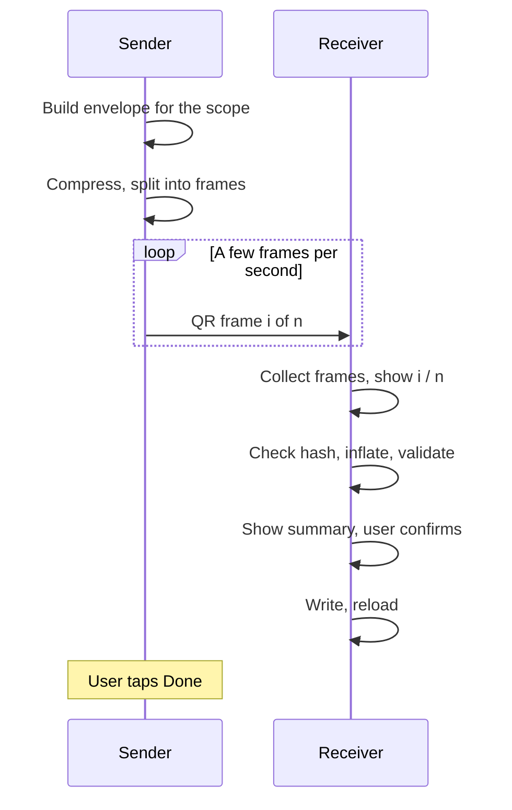

[Wiki](../README.md) › [Roadmap](README.md) › QR Backup

# QR Backup

> **Status:** Built in **[v1.12.0](../features/v1.12.0/README.md)** — [US-057](../features/v1.12.0/US-057-send-backup-by-qr.md) (send) and [US-058](../features/v1.12.0/US-058-receive-backup-by-qr.md) (receive). Waiting on a real phone-to-webcam test.  
> **Origin:** [US-028 Phase 2](../features/v1.7.0/US-028-data-export-backup.md)  
> **Depends on:** Phase 1 file export/import (shipped on Settings → Data)

Back up data from one device to another by pointing a camera at a screen. The sending device shows an **animated QR code**; the receiving device scans it and writes the data. No file, no network, no pairing.

This replaces the earlier device-sync design (QR pairing, LAN or WebRTC transfer, two-way merge engine) — see [Not planned](#not-planned).

---

## Design North Star

> "Your data is yours — take it with you."

One person, one main device. The goal is an easy backup a few times a year, not keeping several devices in step.

---

## Roles

| Role         | Does                                                |
| ------------ | --------------------------------------------------- |
| **Sender**   | Shows the QR. **Source of truth** for what it sends |
| **Receiver** | Scans, verifies, writes                             |

Either device can take either role. The usual direction is phone → desktop (the desktop holds the backup); desktop → phone works the same way (restoring onto a new phone).

The transfer is **one-way**. Nothing travels back from the receiver, so the sender never knows whether the scan worked — the user confirms it on the sender (see [Since last backup](#since-last-backup)).

---

## Scopes

| Scope                | Sent                                                           | Receiver                                                                                                              |
| -------------------- | -------------------------------------------------------------- | --------------------------------------------------------------------------------------------------------------------- |
| **Recent** (default) | Records dated inside a window, plus every user-made definition | Replaces its own records inside the window; upserts definitions; nothing outside the window changes                   |
| **Everything**       | The full Phase 1 envelope                                      | Same as file restore — staged replace of all data ([US-028](../features/v1.7.0/US-028-data-export-backup.md#restore)) |

### Recent — replace the window

**Dated stores:** `sessions`, `habitLogs`, `activities`, `healthReadings`, `baselineLogs`. Every record has a `date` (`YYYY-MM-DD`).

For each dated store, the receiver deletes its records with `date` in `[from, to]` and writes the sender's records for that range. That is why no merge rules are needed:

- Deleting something on the sender deletes it on the receiver next time — no tombstones.
- Sending an overlapping window twice gives the same result, so a window that starts too early is harmless.
- One session per program per day still holds: the receiver's sessions in the window are cleared before the sender's go in.

**Definitions** — user-made `items` and `programs` (`isBuiltIn: false`), `habits`, `goalPlans`, `baselines` — are few and small, so all of them go every time. The receiver **upserts by `id` and never deletes** one, because its records outside the window may still point at it. A definition deleted on the sender stays on the receiver until the next Everything transfer.

**Not sent:** built-in items and programs (`initDB()` rewrites them on every boot) and `activeSession` (crash-recovery state never leaves the device).

**Other state:**

| Data                     | Recent behavior                                                                                               |
| ------------------------ | ------------------------------------------------------------------------------------------------------------- |
| `itemLastUsed`           | Upsert the sender's — it drives next-workout prefill                                                          |
| `cwout:activeProgramIds` | Take the sender's                                                                                             |
| `cwout:lastActivityType` | Take the sender's                                                                                             |
| `cwout:prefs`            | Receiver keeps its own (density, haptics, sound are per-device); Everything restores them like a file restore |

Program progression needs no fix-up: `completedSessionCount` is derived from sessions, never stored.

The receiver applies a Recent transfer in **one IndexedDB `readwrite` transaction** across the affected stores, so a failure leaves it unchanged.

**Known gap:** a record outside the window that was edited on the sender (for example, a habit value corrected for a date months ago) is not sent. Run Everything now and then, or pick a window that covers the edit.

### Since last backup

The sender picks a window:

- **Since last** (default; the range line under the choice shows the date)
- Last 30 days
- Last 90 days
- Everything (default when there has never been a QR backup)

The window always ends today. When the receiver has finished, the user taps **Done** on the sender, which saves today's date as `cwout:lastQrBackupAt` on the sender. If they never tap Done, the next default window starts at the older date — the overlap is harmless. The key is per-device and is **not** included in backups.

---

## Transfer

**Payload**

1. Build the Phase 1 envelope (same `format` and `version`) plus a `scope` field — `{ "kind": "window", "from": "2026-08-12", "to": "2026-10-24" }` or `{ "kind": "full" }`. File backups never carry `scope`, and file restore **refuses** a window backup: replacing everything with a date range would wipe every other day.
2. JSON → UTF-8 → `CompressionStream('deflate-raw')`. Built into the browser; no library.
3. Split the bytes into frames by **density**: low 250, medium 450 (default), high 800 bytes per frame.
4. Encode each frame as text — `CW1:<id>:<index>:<total>:<base45 data>`. Every character is in the QR **alphanumeric** set, which packs about 30% more per code than byte mode, and scanners hand back strings anyway. `id` is the **CRC-32** of the compressed payload as 8 hex digits: it names the transfer and is the checksum. CRC-32 rather than SHA-256 because `crypto.subtle` needs a secure context, and a phone on plain-http `npm run dev --host` must still be able to send.
5. Show each frame for the chosen **speed**: slow 500 ms, normal 250 ms (default), fast 150 ms. Error correction is level L — a screen doesn't get scuffed, and the lower level keeps each square bigger.

**Receiving**

1. Keep distinct frames for the current transfer; a frame with a new id, or the same id with a different total (the sender changed density), starts over. Show progress (`41 / 64`) and a square per frame.
2. When every frame is in: recompute the CRC-32, inflate, parse, and run the Phase 1 checks in `backupPayload.ts`, plus a check that every dated record falls inside the window. **Nothing is written before this passes.**
3. Show a summary before writing — for example _"Aug 12 – Oct 24: 24 sessions, 365 habit logs, 18 activities. Replaces 20 sessions on this device."_
4. On confirm, write (one transaction for Recent; staged restore for Everything), then reload.

**Measured size** (the debug seed — about six months of sessions, habits, activities, health and baselines — at medium density and normal speed, 2026-10-24):

| Window          | Codes | One loop |
| --------------- | ----- | -------- |
| Last 30 days    | 20    | ~5 s     |
| About 2½ months | 43    | ~11 s    |
| Everything      | 98    | ~25 s    |

Reading the on-screen animation back with the browser's built-in reader collected all 20 codes of the 30-day window in 4.7 s — about one loop. Random UUIDs make up most of what's left after compression.

**Libraries** — two, kept to the minimum ([Small Surface Area](../vision/principles.md#5-small-surface-area)):

- [`uqr`](https://github.com/unjs/uqr) (MIT, no dependencies) draws the codes.
- The browser's own `BarcodeDetector` reads them where it supports QR (Chromium on macOS, Android, ChromeOS). Elsewhere — Safari, Firefox — [`jsqr`](https://github.com/cozmo/jsQR) (Apache-2.0) is loaded on demand from the scan screen. It is a normal build chunk, so the service worker precaches it and it works offline. About 25 ms per 960×720 frame on a Mac.

**Camera constraints**

- `getUserMedia` needs a secure context — HTTPS or `localhost`. Phone → desktop works in dev, since the desktop is on `localhost`. Desktop → phone in dev needs HTTPS on the LAN; plain `npm run dev --host` gives the phone no camera.
- The receiver needs a camera. A desktop without a webcam can only send.

**UI:** Settings → Data & backup gets **Send by QR** and **Receive by QR**, next to file export and restore — which stay. The file is still the off-device archive.

---

## Tuning instead of a spike

The main risk is still a laptop webcam reading dense codes off a phone screen. Rather than a throwaway spike, density and speed are settings on the send screen, remembered per device (`cwout:qrSendOptions`), so the first real test finds what works. If a webcam struggles, drop to low density and slow speed: bigger squares, more codes.

**Target:** two months in about 10 seconds, Everything in under a minute. Not yet measured with a real phone and webcam.

---

## Key decisions

- **Backup, not sync.** One person, one main device; no two-way merge.
- **The sender is the source of truth**, in whichever direction it runs.
- **Replace the window instead of merging.** Deletes carry over without tombstones; repeating a window is safe.
- **Definitions upsert, never delete,** in Recent.
- **The QR is the data pipe.** No LAN, no WebRTC, no pairing — works with no network at all.
- **Nothing is written until the whole payload is verified** (CRC-32 plus Phase 1 checks), and a Recent write is one transaction.
- **Built-ins never travel.** Both scopes drop built-in items and programs; every device rebuilds them on boot.
- **Skip `activeSession`.** Unchanged from Phase 1.
- **The receiver keeps its own prefs** in Recent.
- **File export and restore stay.**

---

## Not planned

| Item                                          | Why                                                                                                                                             |
| --------------------------------------------- | ----------------------------------------------------------------------------------------------------------------------------------------------- |
| Two-way merge, multi-device sync              | Single user, one main device. Per-entity merge rules were drafted in this file (then `device-sync.md`) and dropped 2026-10-24 — see git history |
| LAN or WebRTC transfer                        | Dropped 2026-10-24. A web page can't accept LAN connections, and WebRTC needs a handshake in both directions; animated QR needs neither         |
| Change tracking (`updatedAt` on every record) | Only needed to catch edits outside the window; Everything covers that                                                                           |
| Cloud sync (iCloud, Dropbox, Firebase)        | Violates the client-only constraint                                                                                                             |
| Automatic background backup                   | Manual only                                                                                                                                     |

---

## Related

- [Roadmap index](README.md)
- [US-028 Phase 1](../features/v1.7.0/US-028-data-export-backup.md) — shipped file export and restore; the envelope this reuses
- [Offline Strategy](../architecture/offline-strategy.md)
- [Program Progression](../implementation/program-progression.md) — why sessions are one per program per day
